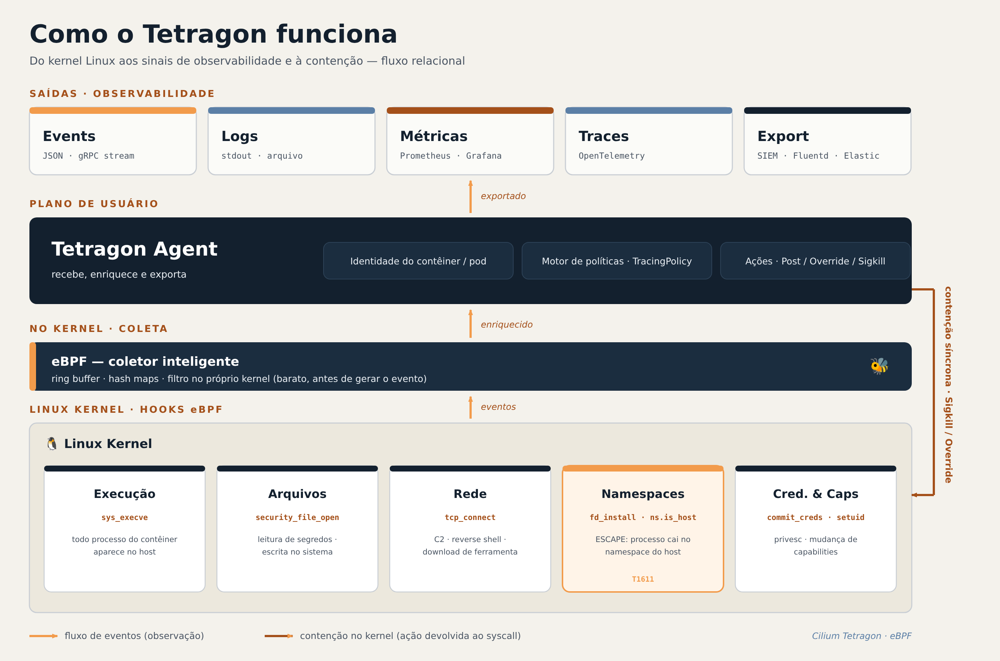
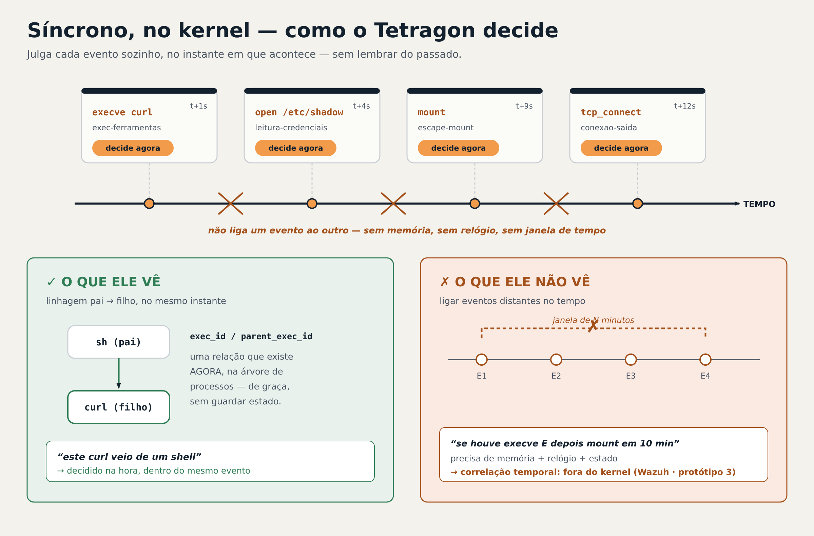

# tetragon-lab

> Detecção e **contenção de _container escape_** em um servidor Docker com **eBPF / Cilium Tetragon**.
> Projeto acadêmico (Sistemas de Informação) estruturado em três protótipos: **observar → conter → enganar**.


> **Para quem lê:** a professora reproduz o lab pelo [Início rápido](#início-rápido); recrutadores
> têm a visão de portfólio (arquitetura + decisões técnicas); pesquisadores encontram as políticas,
> hooks e limites em [`policies/`](policies/) e [`docs/`](docs/).

---

## Sumário
- [Objetivo](#objetivo)
- [Arquitetura](#arquitetura)
- [Os três protótipos](#os-três-protótipos)
- [Estrutura do repositório](#estrutura-do-repositório)
- [Políticas](#políticas)
- [Início rápido](#início-rápido)
- [Como funciona a contenção](#como-funciona-a-contenção)
- [Bases teóricas (frameworks)](#bases-teóricas-frameworks)
- [⚠️ Avisos de segurança](#️-avisos-de-segurança)
- [Licença](#licença)

---

## Objetivo

Usar o **Tetragon** (sensor de runtime baseado em **eBPF**) para **detectar** e depois **conter**
tentativas de *container escape* — quando um processo foge do isolamento do contêiner e alcança o host —
em um servidor **Docker**, sem Kubernetes.

Ideia central: a **mesma política** que *observa* um comportamento passa a *contê-lo* apenas trocando a
ação (`Post` → `Sigkill`/`Override`). Detecção e contenção compartilham o mesmo filtro no kernel.

## Arquitetura



O Tetragon anexa programas eBPF a *hooks* do kernel (execução, arquivos, rede, namespaces, credenciais),
coleta os eventos por *ring buffer*/mapas, enriquece com a identidade do contêiner e exporta como
**Events / Logs / Métricas / Traces**. As políticas (`TracingPolicy`) decidem **no kernel**, de forma
**síncrona**, podendo devolver uma ação ao syscall (contenção).

## Os três protótipos

| # | Protótipo | O que faz | Detalhes |
|---|-----------|-----------|----------|
| 1 | **Observabilidade** | Ver processos, arquivos e rede de todos os contêineres a partir do host | [`docs/prototipo-1-observabilidade.md`](docs/prototipo-1-observabilidade.md) |
| 2 | **Contenção** | Barrar (`Override`) ou encerrar (`Sigkill`) a atividade maliciosa | [`docs/prototipo-2-contencao.md`](docs/prototipo-2-contencao.md) |
| 3 | **Honeypot** | Servidor isca em VPS isolada + correlação temporal (Wazuh) | [`docs/prototipo-3-honeypot.md`](docs/prototipo-3-honeypot.md) |

> O status e os detalhes de cada etapa vivem no respectivo arquivo em `docs/` — assim este README
> permanece estável enquanto o projeto evolui.

## Estrutura do repositório

```
tetragon-lab/
├── README.md                  # visão geral (este arquivo)
├── LICENSE
├── .gitignore
├── docs/                      # um arquivo por protótipo + diagramas e relatório
│   ├── arquitetura.png
│   ├── sincrono.png
│   ├── prototipo-1-observabilidade.md
│   ├── prototipo-2-contencao.md
│   └── prototipo-3-honeypot.md
├── policies/                  # TracingPolicies por tática MITRE
│   ├── README.md              # catálogo (gerado automaticamente) + convenções
│   ├── _template.yaml         # modelo para novas políticas
│   └── <tatica>/...
└── scripts/                   # runbooks executáveis
    ├── 01-instalar.sh
    ├── 02-sincronizar-policies.sh   # sync com pré-check anti-crash
    ├── 03-lab.sh
    ├── 04-simular-ataques.sh
    ├── 05-modo.sh                   # troca monitor<->enforce por comando (sem editar YAML)
    ├── gerar-catalogo.sh            # gera a tabela do catálogo a partir das políticas
    └── filtro.jq
```

## Políticas

As `TracingPolicy` ficam em [`policies/`](policies/), **uma por técnica do MITRE ATT&CK**, organizadas
em pastas por tática. O **catálogo completo é gerado automaticamente** (nome, técnica, hook) — veja
[`policies/README.md`](policies/README.md) e [como adicionar uma política](policies/README.md#como-adicionar-uma-política).

> A tabela do catálogo não é mantida à mão: após criar/editar um `.yaml`, rode
> `bash scripts/gerar-catalogo.sh`.

## Início rápido

> Testado em **Ubuntu Server** · Docker · **Tetragon v1.7.0**. Rode apenas em VM/VPS isolada (ver avisos).

```bash
git clone https://github.com/rafael-msz/tetragon-lab.git
cd tetragon-lab

sudo bash scripts/01-instalar.sh             # Docker + Tetragon
sudo bash scripts/02-sincronizar-policies.sh # carrega as políticas (com pré-check)
sudo bash scripts/03-lab.sh create           # sobe os contêineres-alvo

# Terminal A — observar ao vivo:
sudo tail -n0 -f /var/log/tetragon/tetragon.log | jq -rc -f scripts/filtro.jq
# Terminal B — simular ataques (detalhes no doc do protótipo 2):
sudo bash scripts/04-simular-ataques.sh

# (opcional) ligar a contenção de uma política na hora, sem editar o YAML:
sudo bash scripts/05-modo.sh escape-docker-sock enforce
```

## Como funciona a contenção

- **Síncrona (no kernel, Tetragon):** decide no instante do evento — `Override` (nega a chamada,
  processo segue vivo) ou `Sigkill` (encerra o processo). **Previne**, mas só enxerga o evento atual
  e a linhagem pai→filho; **não** correlaciona uma sequência de N etapas no tempo.
- **Assíncrona (fora do kernel, ex. Wazuh):** reage depois, com estado e janela de tempo
  (`"se A e depois B em N min, então contenha"`). É a **correlação temporal** — tema do protótipo 3.



### Modos de política — ligar a contenção na hora, sem editar o YAML

Cada técnica é **um único YAML**. A troca entre observar e conter usa o recurso **nativo** de modo
do Tetragon (opção `policy-mode` + `tetra tracingpolicy set-mode`), não cópias de arquivo por modo:

| Modo | O que faz |
|------|-----------|
| `monitor` | ações de contenção **elididas** (só conta `NMONITOR`) → observação |
| `enforce` | ações (`Override`/`Sigkill`) **executadas** → contenção |
| `monitor_only` | política sem ação de contenção (só `Post`) — não pode ir a `enforce` |

Políticas com ação de contenção (ex.: `escape-docker-sock`, `escape-mount`) carregam em `monitor`
por padrão (`spec.options: policy-mode`). Para alternar na apresentação:

```bash
sudo bash scripts/05-modo.sh escape-docker-sock enforce   # liga a contenção
sudo bash scripts/05-modo.sh escape-docker-sock monitor   # volta a observar
sudo bash scripts/05-modo.sh list                         # vê o modo de cada política
```

> Adicionar uma técnica = criar **um** arquivo (copie `policies/_template.yaml`) e rodar
> `bash scripts/gerar-catalogo.sh`. README, catálogo e scripts se ajustam sozinhos.

## Bases teóricas (frameworks)

| Camada | Frameworks |
|--------|-----------|
| Modelagem de ataque | **MITRE ATT&CK (Containers)**, **Cyber Kill Chain** (Lockheed Martin), MITRE D3FEND, Unified Kill Chain |
| Segurança de contêiner | **NIST SP 800-190**, **CIS Docker Benchmark**, OWASP Docker Top 10, CNCF Cloud Native Security |
| Detecção / monitoramento | **NIST SP 800-94** (IDS/IPS), NIST SP 800-137 (monitoramento contínuo) |
| Deception (protótipo 3) | **MITRE Engage** |

## ⚠️ Avisos de segurança

- Os contêineres do laboratório são **inseguros de propósito** (expõem `docker.sock`, rodam
  `--privileged`). **Use somente em VM/VPS isolada** e remova-os após os testes.
- **Nunca** baixe mineradores reais: a simulação de *cryptomining* usa apenas carga de CPU benigna.
- Arquivos de evidência (`evidencia-*.json`, logs) podem conter **dados do host** — estão no
  `.gitignore` e **não devem** ser commitados.
- Em VPS, **não exponha** as portas de métricas/observabilidade (2112/9090/3000) à internet.

## Licença

Ver [`LICENSE`](LICENSE).

---

*Autores: Rafael e Ronnald — projeto acadêmico de Sistemas de Informação.*
